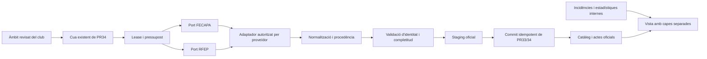

# FED-01 · Proposta de connectors federatius propis

01/11/2026 UTC. Disseny experimental, sense desplegament, migracions, canvis ACL/RLS ni planificador. Evidència i fonts a [l’informe de recerca](FED01_OKMOB_FEDERATION_RESEARCH.md). Els contactes són [esborranys no enviats](FED01_FEDERATION_CONTACT_DRAFTS.md).

## Decisió

Conservar #33 per a importació additiva/validació de dos costats i #34 per a àmbits, cua, leases, hash incremental i backoff. Introduir un port d’adaptadors per proveïdor. FECAPA i RFEP han de tenir configuració i capacitats independents encara que comparteixin actualment fragments SIDGAD. No consumir el backend d’OKMob. No implementar una suposada API Playoff federativa sense tenant, autorització i contracte de dades confirmats.

Preferència: API/exportació oficial suportada → feed estructurat autoritzat → adaptador HTML existent només amb condicions aclarides. La font s’escull per cobertura acreditada i autorització; no canviar de transport per esquivar un 403.



## Model lògic: mapar a taules existents, sense migració FED-01

| Concepte | Clau/procedència | Correspondència existent proposada |
|---|---|---|
| Àmbit d’accés | club autoritzat + federació + temporada + competició; compte tècnic/condicions revisats | Scope/job de #34 |
| Club federatiu | federació + external_club_id; no deduir de nom o dorsal | Catàleg/vincles existents; distingir club gestionat del rival |
| Equip inscrit | federació + temporada + competició + external_team_id | `federation_team_entries`; rival pot tenir `club_team_id=null` segons #33 |
| Competició/grup | federació + temporada + external_competition_id / group_id | `federation_competitions`, `federation_groups` |
| Partit | federació + temporada + competició + external_match_id; fingerprint de calendari abans de publicar ID | `federation_matches`; no fusionar per títol ni primer resultat |
| Persona federativa | namespace federació + external_player_id; estabilitat entre temporades acreditada abans de vincular-les | `federation_players`; UUID intern separat |
| Plantilla de temporada | equip inscrit + persona + interval de vigència + source_kind=season_roster | `federation_team_roster` |
| Llista oficial del partit | partit + costat/equip + persona + dorsal del partit + source_kind=match_lineup | `federation_match_lineups`; diferenciar participant efectiu si la font l’acredita |
| Incidència oficial | ID d’incidència del proveïdor o clau ordinal estable dins de versió d’acta, no nom/jugador únicament | `federation_match_events` |
| Dada interna | ID d’acció + operador + instant + revisió; identitat provisional separada | `pilot_events`, `pilot_operator_state`, sessions/estadístiques existents |

Cada recurs transporta URL oficial, proveïdor/adaptador i versió, data de consulta, hash de contingut, identitat de competició/partit, estat de publicació, completitud i camps no publicats. URL i logs sense credencials. Guardar només camps esportius necessaris; excloure DNI, adreces personals, salut i contactes de jugadors. Definir retenció, rectificació i accés de menors amb la federació abans de la ingesta real.

Dorsal és atribut de participació. No usar-lo com a identitat universal. La fusió d’un provisional intern amb un jugador federatiu requereix ID fiable o confirmació explícita; no canvia retroactivament l’autoria de l’acció.

## Contracte del port

Operacions de **lectura**: `capabilities(scope)`, `listCompetitions(season,cursor)`, `listEntries(competition,cursor)`, `readCalendar(group,cursor,since)`, `readSeasonRoster(entry)`, `readMatchReport(match)`. Noms de contracte propis, no endpoints externs descoberts.

Capacitats independents: calendar, roster, official_lineup, starters, participation, player_ids, incidents, assists, modified_since, etag. `unknown`, `supported` i `unsupported` són diferents. No declarar un camp suportat només perquè el parser tingui una columna preparada.

Resultat normalitzat: `{state, identity, source, fetchedAt, payload, completeness, warnings, retryAfter, cursor}`. Distingir `verified`, `partial`, `not_modified`, `not_published` amb marcador explícit, `empty_response`, `schema_changed`, `upstream_error`, `access_denied`, `rate_limited`, `identity_mismatch` i `persistence_error`.

Regles d’acceptació d’una acta:

1. Scope/partit/equips coincideixen amb els IDs del calendari. Noms només ajuden a detectar discrepàncies.
2. Dues alineacions amb costats i identitats consistents; una taula absent no és «zero jugadors» verificat.
3. Participants sense duplicats; roster de temporada no substitueix convocatòria/acta. No exigir nombre sènior fix a una categoria base.
4. Dorsals/porters/titulars només quan explícits. Assistències, gols, targetes i faltes desconeguts continuen nuls; discrepància amb resultat es registra separadament.
5. Marcador final no prova que plantilla/acta sigui completa. Una acta HTML no certifica automàticament document signat.
6. Parser inesperat → staging parcial/alarma, última versió correcta conservada, mai esborrat massiu.

## Flux incremental i càrrega

1. Validar configuració revisada i condicions d’ús; cap scheduler actiu per defecte.
2. Reutilitzar `federation_claim_job`/lease de #34; pressupost per proveïdor i àmbit, sense N consultes idèntiques per cada club que comparteix competició.
3. Consultar recurs amb timeout i mida màxima; deltes/ETag només si el proveïdor els suporta. Un hash local estalvia commits, no garanteix estalviar descàrregues.
4. Normalitzar, validar i calcular hash excloent data de consulta. La deduplicació de transport pot compartir només dades oficials autoritzades, mai identitat/credencials/permisos d’altres clubs.
5. Staging i commit transaccional backend idempotent amb lease vigent i àmbit correcte. Només avançar checkpoint de recurs després de commit confirmat. ACK perdut: mateixa clau de mutació, no segon event.
6. `federation_finish_job` reflecteix partial/failed i errors d’actes; no sumar «0 errors» a partir d’un success global legacy.
7. Data de proper intent i cooldown; UI conserva el registre intern operatiu i mostra darrera dada correcta/avís discret. Botó manual no salta backoff.

#34 ja limita un torn a una competició i, al worker examinat, tres recursos generals més fins a quatre actes. Mantenir-ho com a pressupost inicial revisable, **no com a límit aprovat per les federacions**. Cadència final pendent de contracte; la declaració de 30 segons d’OKMob no autoritza aquesta freqüència per a ClubHoquei360.

Proposta de política: cap retry automàtic de 401/403; marcar accés pendent i cooldown existent. 429: `Retry-After` i topall operatiu. Timeout/5xx: màxim dos reintents diferits amb backoff i jitter, sense bucle en directe. Format/identitat inesperats: aturar adaptador afectat i conservar catàleg. `not_published` només amb senyal verificat, mai deduït d’HTML buit.

## Compatibilitat exacta amb #33/#34

| Peça revisada | Ús proposat | Límit FED-01 |
|---|---|---|
| #33 head `1b83921` | Imports parcials additius, rivals, IDs federatius, commit atòmic i error d’incidències visible | No es copia ni modifica la migració o PR |
| #34 head `c7e9879` | `club-federation-sync/worker.ts`, scopes, leases, hashes, rotació d’actes pendents i backoff | PR apilada sobre `audit/production-preflight-vic-3a9`; no fusionable com canvi independent de main sense revisió de dependències |
| `syncOfficialReports` | Adaptar entrada normalitzada a `federation_commit_official_report` o wrapper scoped existent | No canviar semàntica de permisos ni ometre la transacció |
| Seguretat 3A.8–3A.13 | Respectar paquet/bloquejos i pla de publicació de la sessió responsable | No reinstal·lar, corregir ACL ni canviar estat de publicació des de FED-01 |
| Estadístiques internes | Conservació íntegra i vista separada | Cap nova mètrica ni substitució per totals oficials |

Una futura instal·lació del fix INSERT de #33 requereix el procés ja establert. No s’ha executat en aquesta investigació. El fet que el fix existeixi no demostra recuperació de les dues alineacions 35559.

## Prototip aïllat i proves executades

Fitxers `research/fed01/contract.mjs` i `contract.test.mjs`, sense dependències externes. No són un parser de resposta real Playoff/SIDGAD. No hi ha `fetch`, client Supabase, SQL, secrets ni tasques periòdiques; el transport injectat només accepta mode `synthetic`. URL de fixture `example.invalid`, IDs/noms ficticis. Mode live retorna `authorization_pending` sense cridar transport.

Executat:

```sh
node --test --test-isolation=none research/fed01/contract.test.mjs
```

**9 proves, 9 correctes, 0 fallades/omissions:** scope federació/temporada; 401/403/429/5xx; buit/404/304; roster rebutjat com acta; rival absent/equip o partit incorrecte amb última acta conservada; duplicat/procedència; nuls i hash idempotent; snapshots immutables sense tocar dades manuals; bloqueig de mode live.

Això valida el contracte sintètic, **no una importació externa ni el parser complet de producte**. No s’han executat SQL, navegador, Auth real, CI del producte o proves de producció noves. No s’han repetit suites de PR amb codi intacte ni s’atribueixen els resultats històrics a FED-01.

## Proves pendents i dependències

- Accés de xarxa autoritzat a portals/proveïdor des d’entorn de prova; no confondre política Codex amb protecció federativa. Confirmació institucional de canal, freqüència, reutilització i comptes de lectura.
- Snapshot real controlat sense incorporar persones reals a commits; fixtures sintètics estructuralment equivalents després de validar format.
- Matriu per font/categoria: SIMAR–Vic 35559, Infantil–Alpicat 152043, FEM11–Barberà amb identitat prèviament resolta; ambdues alineacions i camps opcionals diferenciats.
- Staging aïllat: RLS/ACL de l’importador existent, rollback en fallar incidències, idempotència, reinici entre fetch/commit i lease expirat. Cap d’aquestes proves contra producció.
- Navegador mòbil/tauleta: registre mentre timeout/403 del refresh, identificació manual conservada després d’importació, recuperació entre dispositius amb IDs estables. Mock no equival a font real.
- Retenció i privacitat revisades, inclosos menors; condicions d’escuts/actes i històric. No s’emet dictamen legal de reutilització.

## Pla d’implementació posterior

1. Confirmar via oficial i contracte de recursos per cada federació; decidir API/exportació o suport del transport actual.
2. Descriure capacitats, identitats i marcadors de no-publicació amb evidència; completar prova dirigida 35559 en entorn autoritzat.
3. Implementar adaptador read-only en staging reutilitzant ports i cues; validar amb respostes autoritzades i fixtures sintètics.
4. Integrar només sobre la combinació aprovada de #31–#34/3A.13, resoldre dependències sense reescriure les PR paral·leles.
5. Revisió i autorització separada de publicació; primer SQL/Edge revisats i scheduler apagat, retirar doble consum legacy segons pla de desplegament, activació gradual d’un àmbit.

Riscos principals: canvis d’HTML, dades no publicades, ús incorrecte d’IDs entre federacions/temporades, fals success legacy, scopes de rivals, drets de menors, duplicació del cron antic i API documentada sense tenant aplicable. Cada risc té un punt d’aturada anterior; cap es resol inventant jugadors o demanant revisió manual de totes les dades verificables.
